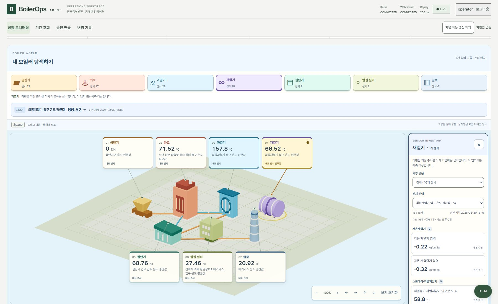
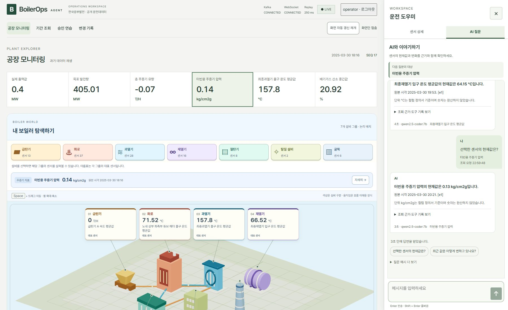
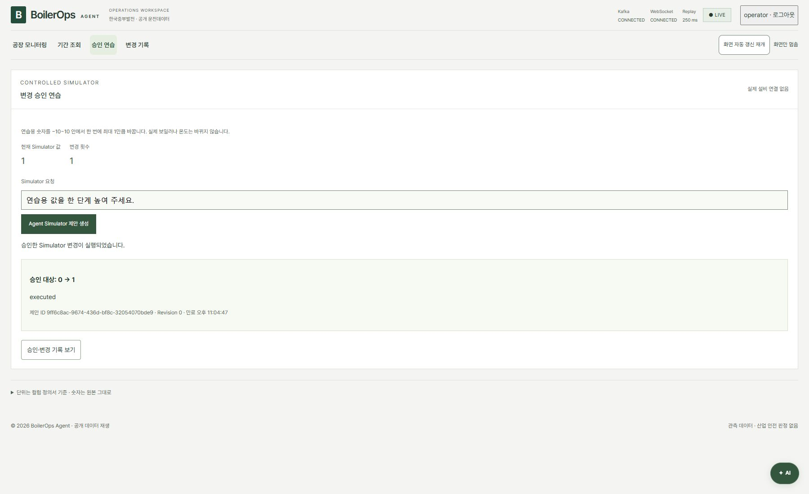

# BoilerOps Agent

보일러의 과거 운전 기록을 내 컴퓨터에서 살펴보는 앱입니다. 공장 그림에서 센서를 찾고, 기간별 변화를 비교하거나 AI에 질문할 수 있습니다. 재열기의 5분 뒤 온도 예측과 변경 승인 연습도 제공합니다.

승인 연습은 별도의 연습용 숫자만 바꿉니다. 실제 발전설비를 제어하지 않습니다.

## 화면 미리보기



| AI 질문과 조회 근거 | 연습용 변경 승인 |
| --- | --- |
|  |  |

위 이미지는 이전 검증 화면이며 현재 앱은 짙은 푸른색을 사용합니다. [당시 검증 기록](docs/results/phase7-select-chat-compare.md)

- **공장 모니터링:** 설비별 센서와 현재값·최근 2분 변화를 확인합니다.
- **기간 조회:** 여러 센서의 원하는 기간을 그래프로 비교합니다.
- **AI 질문:** 센서 값과 변화에 대해 원본 근거와 함께 답변받습니다.
- **5분 예측:** 재열기의 5분 뒤 온도와 시험 오차를 확인합니다.
- **승인 연습·변경 기록:** 연습용 변경안을 승인·거절하고 본인의 결과를 확인합니다.

[사용 안내 영상](https://youtu.be/qmk93cT4LGs) · [자세한 사용법](docs/local-development.md#7-화면에서-차례로-확인)

[그림으로 보는 프로젝트 지도](https://seo-gali.github.io/boiler-ops-agent/)에서 기능과 코드 구조를 볼 수 있습니다. 이 링크는 **설명 페이지**이며, 실제 앱은 아래 방법으로 실행합니다.

## 실행은 이렇게 하세요

### 처음 한 번 준비

- **Node.js 22.12 이상, Python 3.13, uv, Docker Desktop, Ollama**가 필요합니다. 이미 설치했다면 다시 설치하지 않아도 됩니다. [설치 확인 방법](docs/local-development.md)
- 원본 **CSV 파일을 `data/raw/` 폴더에 넣습니다.** CSV는 저장소에 포함되어 있지 않습니다. 기존 `.env`가 있으면 그 파일에 지정된 경로를 사용합니다.

### 실행

**Docker Desktop을 켜고**, 엔진이 준비될 때까지 기다립니다. 이 README와 `package.json`이 있는 프로젝트 폴더에서 PowerShell을 열고 실행하세요.

```powershell
npm start
```

서버와 데이터 재생이 시작되면 브라우저가 열립니다. 열리지 않으면 [http://127.0.0.1:5173](http://127.0.0.1:5173)으로 접속하세요.

처음 실행할 때는 설치와 모델 준비에 시간이 걸립니다. 기본 AI 모델이 없으면 약 4.7GB를 다운로드합니다.

### 로그인과 종료

| 로그인 항목 | 입력할 값 |
| --- | --- |
| 사용자 ID | `operator` |
| 개인 접근 키 | 터미널에 표시된 `operator`의 `Access key:` 뒤의 값 |

**개인 접근 키는 최초 발급하거나 재발급할 때만 표시됩니다.** 평소 `npm start`로 시작하면 기존 키를 사용합니다. 키를 받은 적이 없거나 보관하지 못했다면 바로 아래의 재발급 명령을 사용하세요.

화면의 숫자와 시간이 바뀌면 실행된 것입니다. **종료는 실행한 PowerShell 창에서 Enter**를 누르면 됩니다. 다음에 볼 때도 `npm start`를 실행하세요.

## 개인 접근 키를 모를 때

실행 중인 PowerShell 창에서 **Enter로 앱을 종료**한 뒤, 같은 폴더에서 실행하세요.

```powershell
npm run start:reset-key
```

`operator`의 새 키를 발급하고 앱을 다시 시작합니다. 터미널에 나온 **`Access key:` 뒤의 긴 문자열만 복사**해서 로그인 화면의 개인 접근 키에 붙여넣으세요. 새 키는 안전하게 보관하세요.

이전 operator 키는 더 이상 사용할 수 없습니다. Kafka 설정과 다른 사용자, 기존 조회·승인 기록은 유지됩니다. **`.env.security` 파일을 삭제할 필요가 없습니다.**

## 실행이 안 될 때

| 증상 | 확인할 것 |
| --- | --- |
| `npm` 또는 `uv` 명령을 찾지 못함 | 도구 설치 후 PowerShell을 새로 열기 |
| Docker 연결 실패 | Docker Desktop과 엔진이 준비됐는지 확인 |
| 원본 CSV가 없다는 안내 | `data/raw/`의 파일과 기존 `.env`의 경로 확인 |
| 포트를 사용 중이라는 안내 | 전에 실행한 이 프로젝트를 종료하고 다시 시작 |
| 그 밖의 오류 | 터미널에 표시된 실패 단계와 로그 위치 확인 |

자세한 확인 방법은 [문제 해결 안내](docs/local-development.md)에 있습니다. 설정 파일이나 키를 공유하지 마세요.

## 알아둘 점

### 원본값과 그림의 의미

**2025년 3~4월의 과거 CSV**를 재생합니다. 118개 센서의 단위는 원본 컬럼 정의서에서 확인했습니다. 출력·목표 발전량은 `MW`, 주증기 유량은 `T/H`, 압력은 `kg/cm2g`, 온도는 `°C`, 산소는 `%`입니다. 숫자를 환산하거나 음수를 고치지 않으며, 비어 있는 값을 0으로 채우지 않습니다.

그림의 7개 설비에는 센서 110개가 묶여 있습니다. 주증기 지표 5개·발전 지표 2개·위치 미확인 1개를 더해 전체 118개입니다. 주증기 압력·유량은 과열기의 대표 온도와 다른 센서입니다. 그림의 위치와 움직임은 센서를 찾기 위한 표현이며 실제 설치 위치나 위험도를 뜻하지 않습니다.

급탄기 13개 센서는 전체 50,400행에 누락이나 숫자 읽기 오류가 없습니다. 과거에는 모두 0이 아닌 값이 있지만, `2025-03-28 11:15`부터 원본 끝까지는 0입니다. 이 구간의 0도 정상적으로 읽은 원본값이며 실제 원인은 확인되지 않았습니다. 다른 시각의 값은 `기간 조회`에서 볼 수 있습니다.

기간 그래프는 원본 수치를 사용합니다. 긴 기간에는 실제 기록 중 일부만 표시하고 전체 개수와 표시 개수를 알려줍니다. 값이 비어 있는 구간은 선으로 잇지 않습니다.

### AI·예측·기록의 한계

AI 대화에서는 설비 → 세부 묶음 → 센서 순서로 범위를 좁히고, 현재값과 최근 2분 변화를 볼 수 있습니다. 답변에서도 같은 센서를 더 살펴보거나 후속 질문을 보낼 수 있습니다. 지난 대화는 화면에 남지만 모델이 이전 내용을 기억해 답하는 기능은 아닙니다.

대화와 작성 중인 글은 앱을 열어 둔 동안 보존됩니다. 페이지를 새로고침하거나 로그아웃하면 초기화됩니다.

목표 온도는 원본에 값이 없습니다. 현재 예측 모델도 시험에서 현재 온도를 그대로 유지하는 단순 예측보다 오차가 컸습니다. 실제 설치 위치·안전 기준과 조작 효과가 확인되지 않았으므로 실제 운전 판단에 사용할 수 없습니다. 별도로 제공된 보일러 제원표가 어느 발전소 데이터와 연결되는지도 확인되지 않았습니다.

`npm start`로 실행한 화면은 코드 수정 후 **종료하고 다시 실행**하면 반영됩니다. 저장 즉시 반영하는 개발 서버는 [수동 개발 안내](docs/local-development.md)를 참고하세요.

## 더 자세히 보기

| 보고 싶은 내용 | 문서 |
| --- | --- |
| 기능 흐름·코드 지도·구현 전 설계 | [그림으로 보는 프로젝트 지도](https://seo-gali.github.io/boiler-ops-agent/) |
| 개발 서버를 따로 실행하는 방법 | [수동 개발 안내](docs/local-development.md) |
| 정적 문서·사이트맵을 로컬에서 갱신하는 방법 | [문서 생성·검증](docs/local-development.md#github-pages-검색-노출) |
| 실제 실행과 검수 결과 | [선택 상자·고정 채팅·다중 센서 비교 개정](docs/results/phase7-select-chat-compare.md) · [이전 공장 탐색·대화·기간 조회](docs/results/phase7-game-chat-history.md) · [이전 작업 화면·단위 근거](docs/results/phase7-workspace.md) · [실행 검증](docs/results/phase7-local-start.md) |
| 접근성·보안 점검 | [접근성 검수](docs/results/phase7-ui-accessibility-review.md) · [보안 보완 결과](docs/results/phase7-security-hardening.md) |
| 승인 복구·CSV 한도·HTTP 관측 | [최신 보완 검증](docs/results/phase7-operational-reliability.md) · [현재 시스템 설계](docs/system-design-review.md) |
| 에이전트 작업 규칙 | [작업 진입점](AGENTS.md) · [코딩 기준](CODING_STANDARDS.md) |
| 프로젝트 범위·화면 설계 | [프로젝트 계획](.project/plan.md) · [UI 설계](DESIGN.md) |
