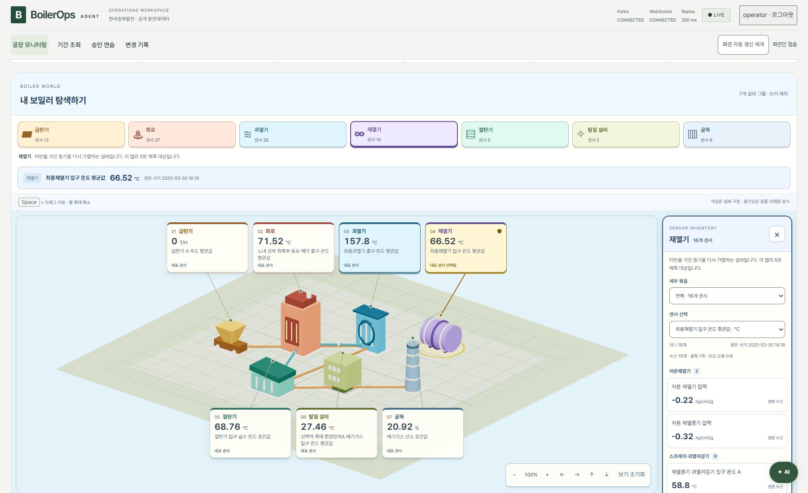
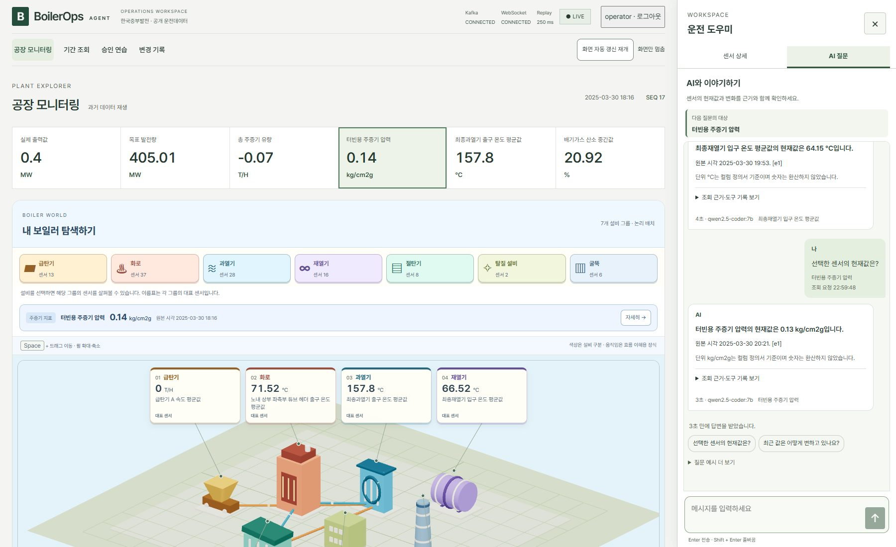
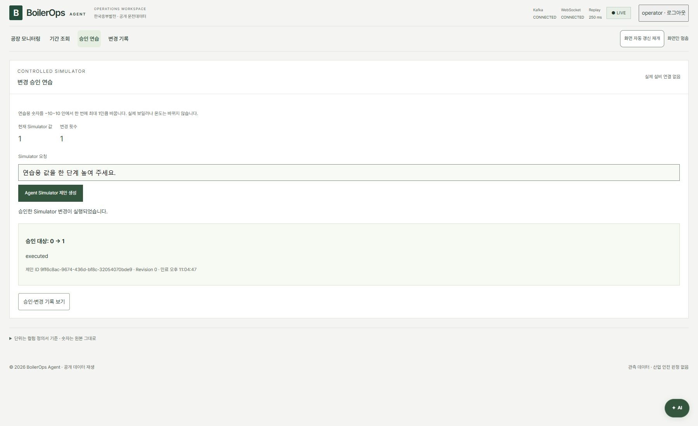

# BoilerOps Agent

보일러의 과거 운전 데이터를 **공장 지도에서 둘러보고, 센서 값·원하는 기간의 변화·AI 답변·5분 뒤 예측**을 확인하는 로컬 앱입니다. 변경 승인은 연습용 Simulator에서만 실행하며, 실제 발전설비를 제어하지 않습니다.

[그림으로 보는 프로젝트 지도](https://seo-gali.github.io/boiler-ops-agent/)에서 기능과 코드 구조를 볼 수 있습니다. 이 링크는 **설명 페이지**이며, 실제 앱은 아래 방법으로 실행합니다.

## 실행은 이렇게 하세요

### 처음 한 번 준비

- **Node.js 22.12 이상, Python 3.13, uv, Docker Desktop, Ollama**가 필요합니다. 이미 설치했다면 다시 설치하지 않아도 됩니다. [설치 확인 방법](docs/local-development.md)
- 원본 **CSV 파일을 `data/raw/` 폴더에 넣습니다.** CSV는 저장소에 포함되어 있지 않습니다. 기존 `.env`가 있으면 그 파일에 지정된 경로를 사용합니다.

### 실행

**Docker Desktop을 켜고**, 엔진이 준비될 때까지 기다립니다. 이 README와 `package.json`이 있는 프로젝트 폴더에서 PowerShell을 열고 실행하세요.

```powershell
npm start
```

서버와 데이터 재생이 자동으로 시작되고 브라우저가 열립니다. 브라우저가 안 열리면 **http://127.0.0.1:5173**으로 접속합니다. 처음에는 설치와 모델 준비에 시간이 걸리며, 기본 AI 모델이 없으면 약 4.7GB를 다운로드합니다.

### 로그인과 종료

| 로그인 항목 | 입력할 값 |
| --- | --- |
| 사용자 ID | `operator` |
| 개인 접근 키 | 터미널에 표시된 `operator`의 `Access key:` 뒤의 값 |

**개인 접근 키는 최초 발급하거나 재발급할 때만 표시됩니다.** 평소 `npm start`로 시작하면 기존 키를 사용합니다. 키를 받은 적이 없거나 보관하지 못했다면 바로 아래의 재발급 명령을 사용하세요.

화면의 숫자와 시간이 바뀌면 실행된 것입니다. **종료는 실행한 PowerShell 창에서 Enter**를 누르면 됩니다. 다음에 볼 때도 `npm start`를 실행하세요.

## 개인 접근 키를 모를 때

실행 중인 PowerShell 창에서 **Enter로 앱을 종료**한 뒤, 같은 폴더에서 실행하세요.

```powershell
npm run start:reset-key
```

`operator`의 새 키를 발급하고 앱을 다시 시작합니다. 터미널에 나온 **`Access key:` 뒤의 긴 문자열만 복사**해서 로그인 화면의 개인 접근 키에 붙여넣으세요. 새 키는 안전하게 보관하세요.

이전 operator 키는 더 이상 사용할 수 없습니다. Kafka 설정과 다른 사용자, 기존 조회·승인 기록은 유지됩니다. **`.env.security` 파일을 삭제할 필요가 없습니다.**

## 실행이 안 될 때

| 증상 | 확인할 것 |
| --- | --- |
| `npm` 또는 `uv` 명령을 찾지 못함 | 도구 설치 후 PowerShell을 새로 열기 |
| Docker 연결 실패 | Docker Desktop과 엔진이 준비됐는지 확인 |
| 원본 CSV가 없다는 안내 | `data/raw/`의 파일과 기존 `.env`의 경로 확인 |
| 포트를 사용 중이라는 안내 | 전에 실행한 이 프로젝트를 종료하고 다시 시작 |
| 그 밖의 오류 | 터미널에 표시된 실패 단계와 로그 위치 확인 |

자세한 확인 방법은 [문제 해결 안내](docs/local-development.md)에 있습니다. 설정 파일이나 키를 공유하지 마세요.

## 화면에서 할 수 있는 것

- **공장 모니터링:** 설비를 누르면 그 설비의 모든 센서와 현재 상태를 볼 수 있습니다. 세부 묶음과 센서를 선택 상자에서 고르고 `선택 센서 자세히 보기`로 원본 근거를 확인합니다. 오른쪽 상세에서는 설비 → 세부 묶음 버튼 → 센서 선택 순서로 전체 118개를 탐색합니다.
- **지도 이동:** 마우스를 지도 위에 두고 **Space + 드래그**로 이동, **Space + 휠**로 확대·축소합니다. 방향·확대 버튼과 `보기 초기화`도 사용할 수 있습니다.
- **기간 조회:** 설비와 센서를 고르고 `센서 추가`로 여러 센서를 담은 뒤 시작·끝 시각을 조회합니다. 같은 단위는 색으로 구분해 한 그래프에서 비교하고 다른 단위는 나누어 표시합니다. 그래프에 마우스를 올리거나 터치하면 해당 시각의 센서별 값이 보이며, 키보드 화살표로도 관측점을 확인할 수 있습니다.
- **AI 질문:** 오른쪽 아래 `AI`나 센서 상세의 제목 옆 질문 버튼을 누릅니다. 고정된 대화 영역 안에서 예시를 고르거나 하단에 메시지를 입력합니다. **Enter로 전송, Shift + Enter로 줄바꿈**합니다. 다른 설비를 둘러봐도 질문 대상은 유지되며, 대상은 `이 센서로 새 질문`으로 바꿉니다.
- **5분 예측:** 공장 지도 바로 아래에서 재열기의 현재 온도·5분 뒤 예측·시험 성능을 함께 봅니다.
- **승인 연습·변경 기록:** 위쪽 메뉴에서 각각 엽니다. 승인 연습은 재열기 AI 조회 근거를 준비하고 연습용 요청을 입력한 뒤 변경안을 확인해 승인·거절합니다. 변경 기록은 본인의 승인 결과를 보여줍니다. 실제 설비에는 연결되지 않습니다.

자동 갱신 일시정지 버튼은 위쪽 메뉴 줄에 있습니다. 연결 상태와 데이터 재생 간격은 LIVE 옆에서 확인합니다.

센서 상세의 추이와 원본값 표는 최신 **원본 시각 기준 최근 120초**만 보여줍니다. 분 단위 자료이므로 두 경계 시각을 포함하면 최대 3행이 보입니다. 전체 과거 기록은 기간 조회에서 확인합니다.

AI 답변을 기다리는 동안 경과 시간이 표시됩니다. 취소하거나 오류 후 다시 조회할 수 있습니다. **X 또는 Esc**로 닫을 때 작성 중인 질문이나 조회가 있으면 먼저 확인합니다. 닫기를 승인하면 답변 기다림을 취소하지만 초안과 대화 기록은 남습니다. 다른 도우미 탭으로 옮기면 조회는 계속됩니다.

아래 캡처는 선택 상자·고정 채팅 개정 당시의 통합 검증 화면입니다. 현재 앱은 푸른 틴트 팔레트를 사용합니다. 해당 버전의 빌드·통합 E2E 13개 항목과 원본 대조·급탄기 감사 결과는 [검증 기록](docs/results/phase7-select-chat-compare.md)에서 확인할 수 있습니다.



| AI 질문과 조회 근거 | 연습용 변경 승인 |
| --- | --- |
|  |  |

## 알아둘 점

- 현재 시각의 설비 데이터가 아니라 **2025년 3~4월의 과거 CSV**를 재생합니다.
- **118개 센서 단위는 원본 컬럼 정의서에서 확인했습니다.** 주요 지표는 출력·목표 발전량 `MW`, 주증기 유량 `T/H`, 압력 `kg/cm2g`, 온도 `°C`, 산소 `%`입니다. 숫자는 환산하지 않으며 음수와 결측도 원본대로 유지합니다.
- 그림의 7개 설비에는 110개 센서가 묶여 있습니다. 주증기 지표 5개·발전 지표 2개·위치 미확인 1개까지 전체 118개를 찾을 수 있습니다. 이 분류와 그림의 움직임은 탐색용이며 실제 설치 위치나 위험도를 뜻하지 않습니다.
- 주증기 압력·유량은 **주증기 지표**로 따로 분류했습니다. 과열기의 대표 온도와는 다른 센서입니다.
- 급탄기 값이 모두 0인 현재 재생 구간도 **정상 수신한 원본값**입니다. 13개 센서는 전체 50,400행에 결측·파싱 오류가 없고 과거에는 모두 0이 아닌 값이 있습니다. `2025-03-28 11:15`부터 원본 끝까지는 모두 0이며, 실제 원인은 자료로 확인되지 않습니다. 다른 시각의 값은 기간 조회에서 볼 수 있습니다.
- AI 대화 기록은 화면에 누적됩니다. 각 질문은 선택한 센서에 대한 독립 조회이며, 이전 대화를 모델이 기억하는 기능은 아닙니다.
- AI 대화 안에서 설비 → 세부 묶음 → 센서로 좁혀 현재값·품질·원본 근거를 확인하고 최근 2분 추이를 펼칠 수 있습니다. 답변에서도 같은 센서의 데이터 탐색과 후속 질문을 이어갑니다.
- 대화와 초안은 앱을 열어 둔 동안 보존됩니다. 페이지 새로고침이나 로그아웃 후에는 초기화됩니다.
- 기간 그래프는 원본 수치를 사용합니다. 긴 기간은 실제 관측점 중 일부를 표시하고 원본·표시 개수를 알려줍니다. 결측 구간은 연결하지 않습니다.
- 목표 온도의 원본 값은 비어 있습니다. 실제 설비 위치·안전 기준과 별도 보일러 제원표의 발전소 연결 관계는 미확인입니다.
- 현재 온도 예측 모델은 시험에서 단순 기준 모델보다 오차가 컸습니다. 실제 운전 판단에 사용할 수 없습니다.
- `npm start`로 실행한 화면은 코드 수정 후 **종료하고 다시 실행**하면 반영됩니다. 저장 즉시 반영하는 개발 서버는 [수동 개발 안내](docs/local-development.md)를 참고하세요.

## 더 자세히 보기

| 보고 싶은 내용 | 문서 |
| --- | --- |
| 기능 흐름·코드 지도·구현 전 설계 | [그림으로 보는 프로젝트 지도](https://seo-gali.github.io/boiler-ops-agent/) |
| 개발 서버를 따로 실행하는 방법 | [수동 개발 안내](docs/local-development.md) |
| 정적 문서·사이트맵을 로컬에서 갱신하는 방법 | [문서 생성·검증](docs/local-development.md#github-pages-검색-노출) |
| 실제 실행과 검수 결과 | [선택 상자·고정 채팅·다중 센서 비교 개정](docs/results/phase7-select-chat-compare.md) · [이전 공장 탐색·대화·기간 조회](docs/results/phase7-game-chat-history.md) · [이전 작업 화면·단위 근거](docs/results/phase7-workspace.md) · [실행 검증](docs/results/phase7-local-start.md) |
| 접근성·보안 점검 | [접근성 검수](docs/results/phase7-ui-accessibility-review.md) · [보안 보완 결과](docs/results/phase7-security-hardening.md) |
| 에이전트 작업 규칙 | [작업 진입점](AGENTS.md) · [코딩 기준](CODING_STANDARDS.md) |
| 프로젝트 범위·화면 설계 | [프로젝트 계획](.project/plan.md) · [UI 설계](DESIGN.md) |
