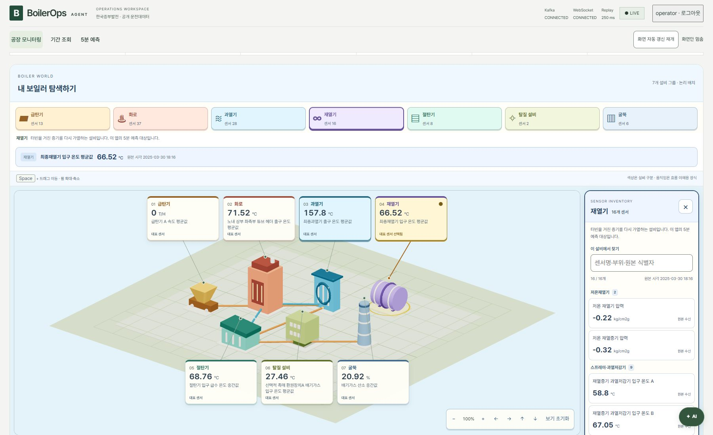
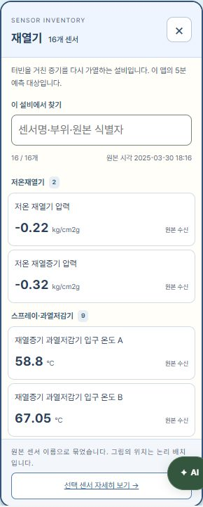
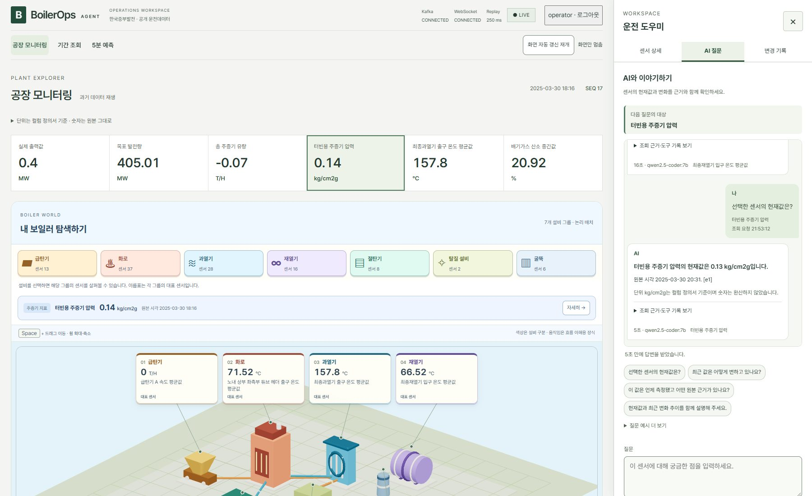
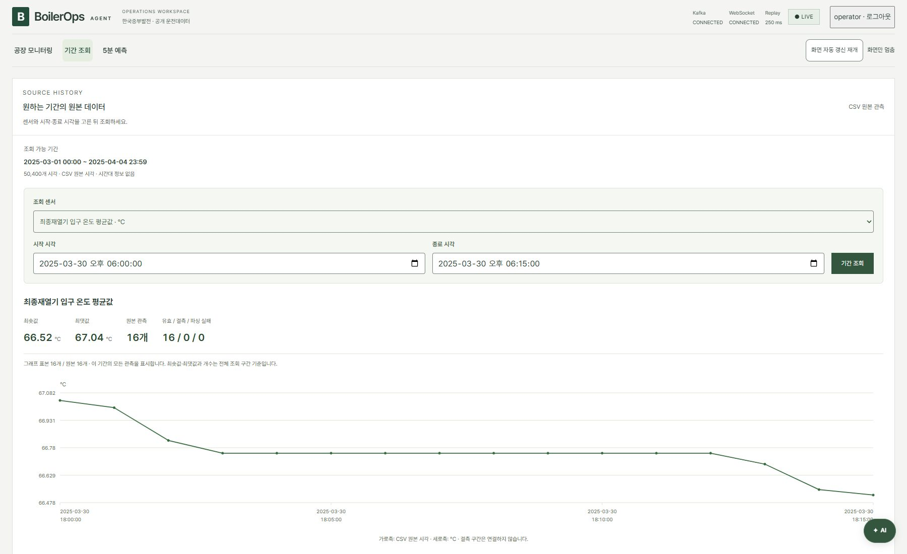

# Phase 7 — 공장 탐색·대화·원본 기간 조회 기록

## 현재 검증 상태

2026년 10월 13일 최종 통합 E2E의 12개 검증 항목이 모두 통과했다. 실행 시각은 21:51:52~21:53:37 KST이며 `run.json`에는 UTC로 기록했다. TypeScript 검사와 프론트엔드 빌드, 설명 페이지의 링크·화면 폭별 읽기·같은 페이지 문서 열기 검사도 통과했다. 이전 `phase7-workspace.md`와 그 화면 캡처는 이전 버전의 기록으로 보존했다.

## 추가 개정 범위

| 사용자에게 보이는 변경 | 계약과 데이터 경계 |
| --- | --- |
| 게임처럼 탐색하는 공장 지도 | 7개 논리 설비와 장식 움직임. 실제 위치·운전 상태·위험도 추정 없음 |
| 설비의 모든 센서 목록 | 원본 이름의 세부 묶음, 현재값·단위·원본 식별자, 전체 검색 |
| 주증기 분류 분리 | 그림 그룹 110개 + 주증기 5개 + 발전 2개 + 위치 미확인 1개 = 118개 |
| 누적 AI 대화 | 질문·답변·근거를 순서대로 표시. 각 질문은 독립 서버 조회 |
| X 닫기와 초안 보호 | 초안·대기 중 확인, 승인 시 기다림 취소·내용 보존, 탭 이동은 조회 계속 |
| 원하는 원본 기간 조회 | 인증된 읽기 전용 CSV 조회, 실제 관측점·원본 수치·결측 보존 |
| 상단 조작 정리 | 자동 갱신은 메뉴 줄, 연결 상태는 LIVE 옆, 반복 수신 표 제거 |

## 데이터 분류의 근거

주증기 지표는 `총 주증기 유량`, `주증기 압력 중간값 A`, `주증기 압력 중간값 B`, `터빈용 주증기 압력`, `주증기 유량` 5개다. 원본 이름은 주증기 지표라는 사실을 알려주지만 과열기의 실제 설치 센서라는 근거는 제공하지 않는다. 따라서 대표 과열기 온도와 같은 센서로 선택하거나 그 설치 위치를 그리지 않는다.

세부 묶음은 `sensor-catalog.ts`에서 원본 이름으로 만든다. 급탄기 A~F, 노내 튜브·헤더, 기수분리기, 버너, 연소공기, 스프레이·과열저감기, 과열·재열 구간, 산소·질소산화물 등 검색과 탐색을 위한 분류다. 원본 Tag와 정의서의 단위·행 번호 연결은 유지한다.

## 호출과 상태 계약

```text
설비·KPI·목록 → selectedTag → 원본값 상세
질문 대상 명시 선택 → questionTag → AgentQuery(question, equipment, tag)
                                      ↓
                               답변·Trace·처리 시간 → 대화 기록에 추가

X/Escape + 초안/대기 → 확인 취소: 유지
                    → 확인 승인: 브라우저 대기 취소, 초안·대화 보존
다른 탭 + 확인 승인 → 조회 계속, 복귀하면 결과 확인

GET /api/history/metadata → 원본 기간·행 수·시간대 정보
GET /api/history/range   → 선택 기간의 실제 관측점 → SVG 그래프
```

대화 기록은 브라우저 화면 상태다. 이전 대화를 서버 모델의 입력에 자동으로 추가하는 다중 대화 API는 이번 범위에 포함하지 않는다. 기다림 취소는 이미 시작된 서버 작업의 중단을 보장하지 않는다.

새로고침·로그아웃은 화면의 대화와 초안을 초기화한다. 화면 갱신 일시정지는 화면 숫자를 멈추며 서버의 데이터 수집이나 별도 AI 조회를 멈추지 않는다. 따라서 AI 답변은 답변에 적힌 원본 시각을 기준으로 읽는다.

## 이번 검증 기록

실제 공개 CSV, Kafka, FastAPI, Ollama `qwen2.5-coder:7b`, Chromium을 사용했다. API `8001`, 화면 `4178`, Kafka `19092`와 임시 인증 계정으로 사용자 실행 환경과 분리했다. 검증이 끝난 뒤 테스트 서버와 Kafka를 정리했다.

| 검증 항목 | 실제 확인 결과 |
| --- | --- |
| 단위·상단 조작 | 118개 정의서 단위 일치, 로컬 Pretendard 로딩, 메뉴 줄의 갱신 버튼·LIVE 옆 연결 상태, 반복 수신 표 제거 |
| 설비별 전체 목록 | 7개 설비의 모든 소속 센서·값·단위·수신 품질과 선택 동작 일치 |
| 분류와 검색 | 110 + 5 + 2 + 1 = 118개 접근, 세부 묶음·원본 식별자 검색·종류 필터·빈 검색 안내 |
| 게임 지도 조작 | 서로 다른 색·형태, 구조물·대표 이름표 클릭, Space 이동·휠 확대, 170% 라벨 겹침·잘림 없음, 움직임 줄이기 설정 반영 |
| 첫 실제 질문 | 답변 숫자를 Trace 도구 결과와 대조, 초안·대기 중 X/탭 확인 취소, 키보드 초점 유지, 승인한 탭 이동에서도 조회 계속 |
| 승인 연습 | 실제 모델 제안·명시적 확인·Simulator 실행·같은 페이지 Audit 대조 |
| 누적 대화와 실패 | 두 실제 질문·답변 보존, 다른 센서 탐색 중 대상 고정, 닫기 승인 후 대기 취소·초안 유지, 늦은 응답·오류·시간 초과·재시도 분리 |
| 원본 기간 API | 메타데이터 50,400행 일치, 원본 16개 시각·문자열·숫자 대조, 전체 기간의 실제 점 120개와 양 끝 행 보존, 무인증 401·알 수 없는 Tag 404·잘못된 기간/시간대 422 |
| 별도 조회·예측 화면 | 날짜 입력 후 그래프와 단위 표시, 전부 결측인 목표 센서·빈 기간 안내, 예측 화면의 Naive 비교 유지 |
| 반응형·키보드 | 1800/1280/900/768/375/320px, 목록·채팅 가로 넘침 없음, 메뉴와 Escape 초점 복귀, 새 탭·다운로드 없음 |
| WebGL 실패 | 3D 컨텍스트를 잃어도 설비별 목록과 센서 선택 유지 |
| 기록 보호 | 임시 접근 키·Kafka 비밀번호가 JSON·텔레메트리·로그 아티팩트에 없음 |

첫 실제 답변은 `최종재열기 입구 온도 평균값`의 **65.18 °C**, 원본 시각 `2025-03-30 19:14`였다. 두 번째는 `터빈용 주증기 압력`의 **0.13 kg/cm2g**, 원본 시각 `2025-03-30 20:31`이었다. 서로 다른 질문 대상과 원본 시각을 대화에 보존했다. 대기 상태 검증에서는 실제 응답 전달을 잠시 보류했으며, 늦은 응답·네트워크 실패·6분 30초 시간 초과는 브라우저에서 주입한 실패 상황이다. 이 실패 주입 결과를 실제 모델 장애로 기록하지 않는다.

기간 조회는 `2025-03-01 00:00`~`2025-04-04 23:59`의 원본 **50,400행**을 대상으로 한다. 짧은 조회는 `2025-03-30 18:00`~`18:15`의 16행, 최솟값 66.52 °C·최댓값 67.04 °C였다. CSV 행 번호에는 헤더를 포함한다. 전체 기간에서 고른 120개는 평균이나 가공 값이 아닌 실제 관측점이며 첫 CSV 2행과 마지막 50,401행을 포함했다.

별도의 임시 CSV로 음수·소수, 생략된 결측·파싱 실패 구간의 연결선 단절, 읽는 도중 파일 변경 거부, 행별 시간대 오프셋 변경 거부도 확인했다. 결과는 `artifacts/e2e/history-boundaries.json`에 있다. 원본 CSV는 변경하지 않았다. 이번 원본에는 시간대 정보가 없어 KST나 UTC를 임의로 붙이지 않는다.

통합 과정에서 발견한 선택 분류 버튼의 낮은 글자 대비와 탭 이동 취소 후 키보드 초점 이동을 수정했다. 장식 애니메이션은 유효한 양의 프레임 시간만 사용하도록 보완했다. 수정 후 위 12개 항목 전체를 다시 통과했다.

## 재현과 아티팩트

```powershell
npm.cmd run build --prefix frontend
$env:E2E_WORKSPACE = '1'
$env:E2E_API_PORT = '8001'
$env:E2E_FRONTEND_PORT = '4178'
node scripts/e2e.mjs
```

Docker Desktop 엔진과 Ollama가 실행 중이고, 기존 모델·Chromium·프로젝트 의존성이 설치되어 있어야 한다. API·화면·Kafka의 위 포트가 비어 있어야 한다. 원본 데이터와 정의서는 기존 로컬 파일을 사용한다.

| 기록 경로 (`artifacts/e2e/phase7/workspace/`) | 내용 |
| --- | --- |
| `run.json` | 시작·종료 시각, 입력 해시, 12개 검증 항목과 `passed: true` |
| `input.json` · `telemetry.jsonl` | 원본 프로파일·재생 관측 기록 |
| `agent-answer.json` · `chat-pressure-answer.json` | 두 실제 답변과 원본 근거 |
| `simulator-audit.json` | 실제 제안·승인·실행 기록 |
| `history-range.json` | 전체 메타데이터·16행 조회·120개 원본 표본 |
| `game-workspace.jpg` · `equipment-sensors.jpg` · `sensor-catalog.jpg` | 게임 지도·설비 목록·전체 분류 |
| `chat-history.jpg` · `period-history.jpg` | 누적 대화·기간 그래프 |
| `workspace-*.json` · `chat-*.json` | 화면 폭별 넘침·접근 가능한 이름·대비 검사 |

CSV SHA-256: `fb995b76ab26e11f2c66226c9b2aa54388e0c04e41d6ce3a8106cef804cd2419`.

`scripts/build-guide.py`로 54개 문서·소스 미리보기를 다시 생성했고 `node scripts/review-ui.mjs`로 설명 페이지 검수도 통과했다. 문서 검수 결과는 `artifacts/e2e/phase7/ui-review/docs-result.json`에 기록했다.

## 실제 화면









## 검증의 한계

실제 설비 연결·설치 위치·위험 기준은 확인하지 않았다. NVDA·VoiceOver의 실제 음성 낭독과 외부 배포 검증은 실행하지 않았다. 이번 실행은 변경한 사용자 경로에 집중한 E2E이며 기존 전체 보안 회귀 스위트를 다시 실행한 결과는 아니다. 빌드에는 기존 대용량 JavaScript 청크 안내가 남아 있다.

## 관련 문서

- [구현·실패 검증 계약](../instructions/phase7-workspace.md)
- [이전 작업 화면과 단위 근거](phase7-workspace.md)
- [프로젝트 범위](../../.project/plan.md)
- [화면 설계](../../DESIGN.md)
