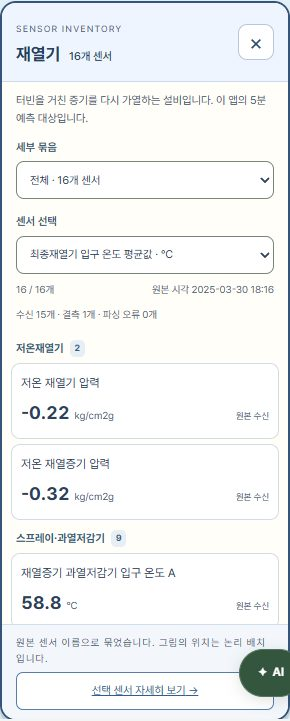
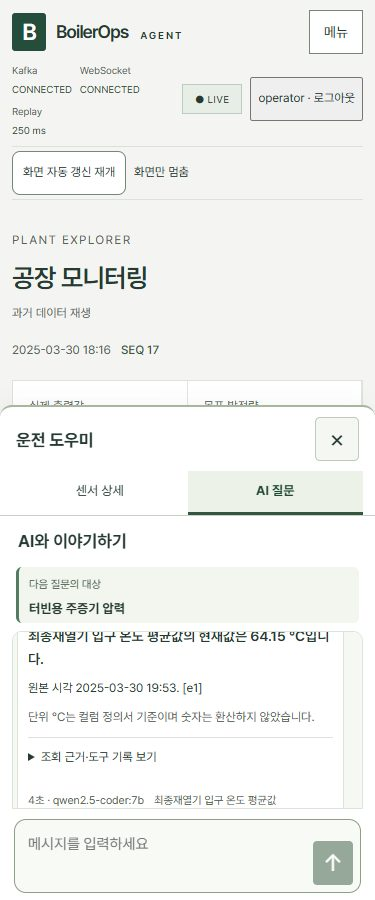
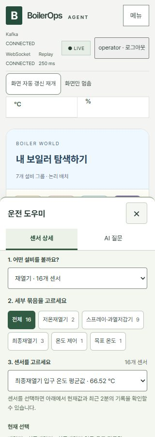
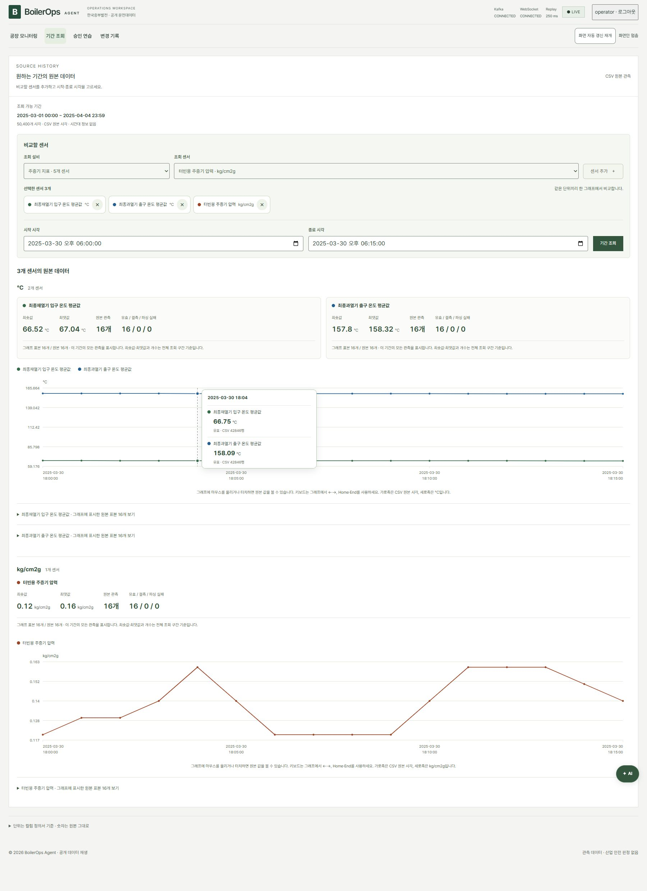
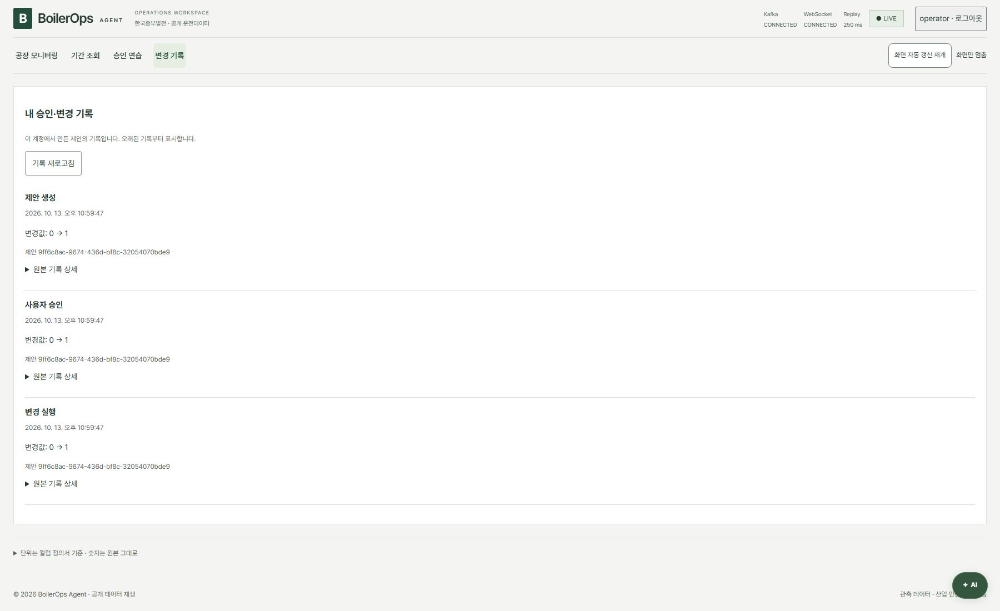

# Phase 7 — 선택 상자·고정 채팅·다중 센서 비교 기록

## 현재 상태: 개정·통합 검증 완료

2026년 10월 13일 추가 사용자 요청을 반영했다. 프론트엔드 빌드와 실제 CSV·Kafka·API·Ollama·Chromium 통합 검증 13개 항목이 통과했고 새 화면 캡처를 남겼다. 설명 페이지 브라우저 검수도 통과했다. 이전 `phase7-game-chat-history.md`, `phase7-workspace.md`와 기존 이미지는 이전 버전의 검증 기록으로 보존한다.

## 이번 변경 계약

| 사용자 요청 | 이번 동작 |
| --- | --- |
| 그래프에 마우스를 올려 상세 값 확인 | 원본 관측점의 시각·센서별 값·단위·품질·행 표시, 터치·방향키도 지원 |
| 조회 센서 디자인·여러 개 선택 | 설비·센서 선택 상자 → 추가·제외 칩, 같은 단위 색상 비교·다른 단위 그래프 분리 |
| 5분 예측을 공장 아래로 | 공장 모니터링에서 지도와 재열기 예측·시험 성능을 함께 표시 |
| 입력 검색 대신 선택 상자 | 오른쪽 설비 → 묶음 버튼 → 센서 선택, 설비 팝업 묶음·센서 선택과 상태 목록 |
| 전체 검색 링크·중복 목록 제거 | 전체 118개는 설비 분류로 접근, 검색 입력과 `전체 118개에서 찾기` 삭제 |
| 노란 기본 설명 상자 제거 | 기본 `title` 제거, 기능명·입력 레이블·접근 가능한 이름·키보드 포커스 유지 |
| 단위 안내를 하단으로 | 본문 가장 아래 안내로 이동 |
| 부드러운 패널 진입 | 짧은 열기 애니메이션, reduced motion에서는 움직임 축소 |
| 질문 버튼 위치·최근 값 휘발성 | 분류 제목 옆 질문 버튼, 센서 상세 추이·원본 표는 최신 원본 시각 기준 120초 |
| 챗봇처럼 고정된 질문·답변 | 고정 대화 영역 안 메시지·예시, 하단 입력·전송, Enter 전송·Shift+Enter 줄바꿈 |
| 승인 연습·변경 기록 메뉴 | 메인 메뉴 `공장 모니터링 | 기간 조회 | 승인 연습 | 변경 기록`, 오른쪽은 두 탭 |

원본 수치·음수·결측·단위를 바꾸지 않는다. 그림의 설비 배치와 움직임은 탐색용이며 실제 설치 위치·운전 상태·위험도·제어 효과를 뜻하지 않는다. AI 질문은 선택 센서의 독립 조회이며 화면에 쌓인 이전 대화를 서버가 자동으로 기억하지 않는다.

## 급탄기 데이터 감사: 0은 결측이 아니다

공개 원본 CSV 전체 **50,400행**, 원본 기간 **2025-03-01 00:00~2025-04-04 23:59**를 직접 순회했다. 급탄기 그룹의 13개 Tag는 모두 각 50,400개의 유효 수치를 갖고 있으며 결측과 파싱 실패는 각각 0개다. 13개 모두 과거에 0이 아닌 값이 있다.

| 원본 센서 | 단위 | 0인 행 | 0이 아닌 행 | 최솟값 | 최댓값 |
| --- | --- | --- | --- | --- | --- |
| 석탄 유량 제어 | % | 27,106 | 23,294 | 0 | 100 |
| 급탄기 A 요구값 | % | 27,690 | 22,710 | 0 | 92.03 |
| 급탄기 A 속도 평균값 | T/H | 27,695 | 22,705 | 0 | 43.23 |
| 급탄기 B 요구값 | % | 28,379 | 22,021 | 0 | 90.13 |
| 급탄기 B 속도 평균값 | T/H | 28,390 | 22,010 | 0 | 41.59 |
| 급탄기 C 요구값 | % | 27,312 | 23,088 | 0 | 92.35 |
| 급탄기 C 속도 평균값 | T/H | 27,318 | 23,082 | 0 | 42.64 |
| 급탄기 D 요구값 | % | 29,547 | 20,853 | 0 | 93.99 |
| 급탄기 D 속도 평균값 | T/H | 29,556 | 20,844 | 0 | 43.81 |
| 급탄기 E 요구값 | % | 27,852 | 22,548 | 0 | 91.12 |
| 급탄기 E 속도 평균값 | T/H | 27,858 | 22,542 | 0 | 42.08 |
| 급탄기 F 요구값 | % | 47,271 | 3,129 | 0 | 77.93 |
| 급탄기 F 속도 평균값 | T/H | 47,283 | 3,117 | 0 | 36.83 |

원본에서 마지막으로 0이 아닌 급탄기 그룹 값이 나오는 시각은 **2025-03-28 11:14**, 데이터 행 39,555다. 다음 시각인 **2025-03-28 11:15부터 원본 끝까지 10,845행**에서는 13개 모두 0이다. 여기서 데이터 행 번호는 헤더를 제외한 1부터의 번호다.

이번 통합 E2E는 예측 시험 구간 시작인 데이터 행 **42,841(2025-03-30 18:00)**부터 재생한다. 확인한 재생 범위 **42,841~46,440(2025-04-02 05:59)**의 3,600행에서도 13개 모두 원본 문자열 `0`, 유효 수치 0이었다. 따라서 사용자 화면의 급탄기 0은 해당 구간의 원본값이며, 센서 누락이나 결측의 임의 대체가 아니다.

정의서 `CustomExcelView.xlsx`의 **행 6~18**을 ZIP 내부 XML로 직접 읽어 원본 Tag, 식별자와 단위를 `sensor_definitions.json`·Registry와 대조했다. 석탄 유량 제어·급탄기 요구값은 `%`, 속도 평균값은 `T/H`다. 정의서 단위는 G열이 비어 있어 C열 설명에서 확인하며, 속도 평균값 원본 Tag의 끝 공백도 그대로 유지한다.

| 원본 파일 | SHA-256 |
| --- | --- |
| 운전데이터 CSV | `fb995b76ab26e11f2c66226c9b2aa54388e0c04e41d6ce3a8106cef804cd2419` |
| CustomExcelView.xlsx | `7b5b753c4ea18c1cc9fd5487b29d91a0696d6d742c9995ccc5feb87adbfa36ce` |

`BoilerState.apply`의 실제 파싱 경로에 재생 첫 행을 넣어 `raw: "0"`, `value: 0.0`, `quality: "valid"`, `error: null`을 확인했다. `formatValue`도 값이 null인 경우에만 `—`를 표시한다. 실제 설비가 정지했는지, 정비 중인지, 데이터 수집 방식 때문인지 등의 **물리적 원인은 제공 자료로 확인되지 않는다.** 이번 UI는 정상 수신한 0과 결측을 구분하고 다른 시각은 기간 조회에서 확인하도록 안내한다.

감사 아티팩트는 로컬 `artifacts/e2e/feeder-data-audit.json`이다. 파일별 해시·전체 기간·재생 범위·각 센서의 유효/결측/파싱 실패/0/비영값 수·최소/최대·정의서 행·식별자·최초/최후 비영값·실제 파싱 결과를 담았다. 공개 원본만 읽었으며 설정·인증 파일과 원본 데이터는 변경하지 않았다.

## 원본 기록과 기간 비교의 경계

- 센서 상세의 2분은 브라우저 벽시계 시간이 아니라 **최신 원본 시각에서 120초**다. 분 단위 원본의 경계값을 포함하면 3개 관측이 보일 수 있다. 서버 이력과 원본 CSV를 삭제하거나 AI 근거 전체를 2분으로 제한하는 변경이 아니다.
- 원본 기간 비교는 선택한 센서마다 기존 인증된 읽기 전용 range API를 호출한다. 동일 단위끼리만 수치 축을 공유하고 다른 단위는 나눈다. 각 센서의 실패·빈 결과·결측을 따로 표시한다.
- 긴 기간의 그래프는 센서별 최대 1,000개의 실제 원본 행을 균등 선택한다. 상세 값은 그 원본 관측점이며 전체 기간의 모든 분을 표시한다는 의미가 아니다. 임의 평균·보간·결측 대체를 만들지 않는다.
- 그래프의 선택 시각과 센서별 원본 시각을 구분한다. 단위 미확인 센서를 같은 축에 합치거나 온도·압력·유량을 임의 환산하지 않는다.
- 채팅 기록과 초안은 앱을 열어 둔 동안 보존한다. X/Escape 닫기에서 확인한 뒤 답변 기다림을 취소하더라도 기록·초안이 남는다. 페이지 새로고침·로그아웃은 초기화될 수 있으며 실제 안내와 일치해야 한다.

## 이번 검증 기록

실행 명령:

```powershell
npm.cmd run build --prefix frontend
$env:E2E_WORKSPACE='1'
$env:E2E_API_PORT='8001'
$env:E2E_FRONTEND_PORT='4178'
node scripts/e2e.mjs
```

최종 통합 실행은 **2026-10-13 22:58:34~23:00:23 KST**, **13개 항목 통과**, `run.json`의 `passed: true`다. 실제 공개 CSV SHA-256은 위 감사 값과 일치한다. 별도 포트 8001·4178, 별도 Kafka 19092와 임시 계정을 사용했으며 실행 후 테스트 서버와 컨테이너를 정리했다. 사용자 실행 환경은 중단하지 않았다.

| 검증 | 실제 확인 결과 |
| --- | --- |
| TypeScript·Vite 빌드 | `npm.cmd run build --prefix frontend` 종료 코드 0, 74 modules |
| 원본 CSV·정의서 | 118개 단위·원본 Tag·해시 일치, 급탄기 전체 50,400행 감사 완료 |
| 설비 목록·선택 상자 | 7개 설비 팝업의 전체 센서·현재값·품질, 세부 묶음 select·센서 select, 오른쪽 분류로 118개 모두 접근 |
| 급탄기·2분 추이 | 급탄기 13개 valid 0·결측 0 안내, 원본 표 3행·시각 간격 120초·원본 0 보존 |
| AI 대화 | 실제 Ollama 두 답변·Trace 근거 대조, 질문 대상 고정·대화 누적·Enter 전송·Shift+Enter 줄바꿈 |
| 닫기·재시도 | 초안·대기 중 확인 취소/승인, X 닫기 취소·초안 보존, 늦은 응답 무시, 네트워크 오류·6분30초 타임아웃·재시도 |
| 승인 연습·변경 기록 | 메인 승인 연습에서 실제 모델 제안·명시적 승인·Simulator 실행·본인 Audit 확인 |
| 원본 기간 API | 인증 없는 요청 거부, Tag·역순 기간·시간대 오류 거부, raw·원본 시각·CSV 행 대조, 전체 50,400행의 실제 표본 120개와 양끝 보존 |
| 다중 센서·hover | 온도 2개는 °C 한 축, 압력은 별도 kg/cm2g 축; 마우스·Home·방향키·Escape, raw·원본 시각·CSV 행 대조; 개별 503 실패 시 나머지 결과 유지 |
| 기간 경계·배치 | 센서 미선택·빈 기간·목표값 결측, 급탄기 첫날 비영값 조회; 예측은 공장 아래, 단위 안내는 본문 끝 |
| 지도·동작 축소 | 7개 mesh·대표 이름표 선택, Space 이동·확대·170% 배치, reduced motion에서 장식과 패널 애니메이션 중단 |
| 화면·접근성 | 1800·1280·900·768·375·320px 및 높이 400px에서 입력·전송 노출; 이름·대비·가로 넘침·키보드·포커스 복귀 검사 |
| WebGL·인증 정보 | WebGL 손실 시 설비 탐색 유지, JSON·이력·로그에 임시 인증 정보 미포함 |
| 설명 페이지 | `node scripts/review-ui.mjs` 종료 코드 0, 링크·문서·새 8개 이미지·키보드·320/375/768/1440px 읽기 화면 확인, 2026-10-13 23:04:56 KST |

실제 모델은 **qwen2.5-coder:7b**이다. 재열기 답변은 “최종재열기 입구 온도 평균값의 현재값은 64.15 °C입니다.”, 압력 답변은 “터빈용 주증기 압력의 현재값은 0.13 kg/cm2g입니다.”였다. 재열기 질문의 브라우저 흐름과 응답·Trace 저장까지 4.97초가 걸렸으며, 각 답변은 그 조회의 원본 시각을 표시한다. 화면 자동 갱신을 멈춘 값과 별도 AI 조회의 시각이 같다고 가정하지 않는다.

첫 검증에서 선택 칩 제거 테스트의 변하는 인덱스를 수정했고, 지도 크기 변경 후 투영값을 기다리도록 조정했다. 추가 코드 검수에서 낮은 화면 높이의 채팅 클리핑과 취소된 추이 응답의 경계를 보완했다. 문서 촬영에서는 그래프가 화면 밖에 있던 캡처 크기를 조정한 뒤 최종 실행을 통과했다.

로컬 실행 아티팩트는 `artifacts/e2e/phase7/workspace/`의 `run.json`, `input.json`, `agent-answer.json`, `chat-pressure-answer.json`, `simulator-audit.json`, `history-range.json`, `feeder-history.json`, 화면별 접근성 JSON/YAML과 JPG다. 스크립트 5개의 `node --check`도 통과했다. 기존 전체 보안·Phase 7 실행을 이번에 다시 수행한 기록은 아니다.

설명 페이지 결과는 `artifacts/e2e/phase7/ui-review/docs-result.json`의 `passed: true`다. 안내 페이지에 이전 다섯 질문 검수 기록의 버튼을 복구했고, 새 결과서와 8개 이미지를 같은 페이지에서 확인했다.

실기기 터치·한글 IME와 실제 스크린리더 수동 검수는 수행하지 않았다. Chromium 접근성 트리와 브라우저 키보드 경로를 확인했다. Vite의 기존 큰 번들 경고는 남아 있으며 빌드는 성공했다. 실제 발전설비 운전 원인은 공개 원본으로 확인되지 않는다.

## 이번 화면 캡처













